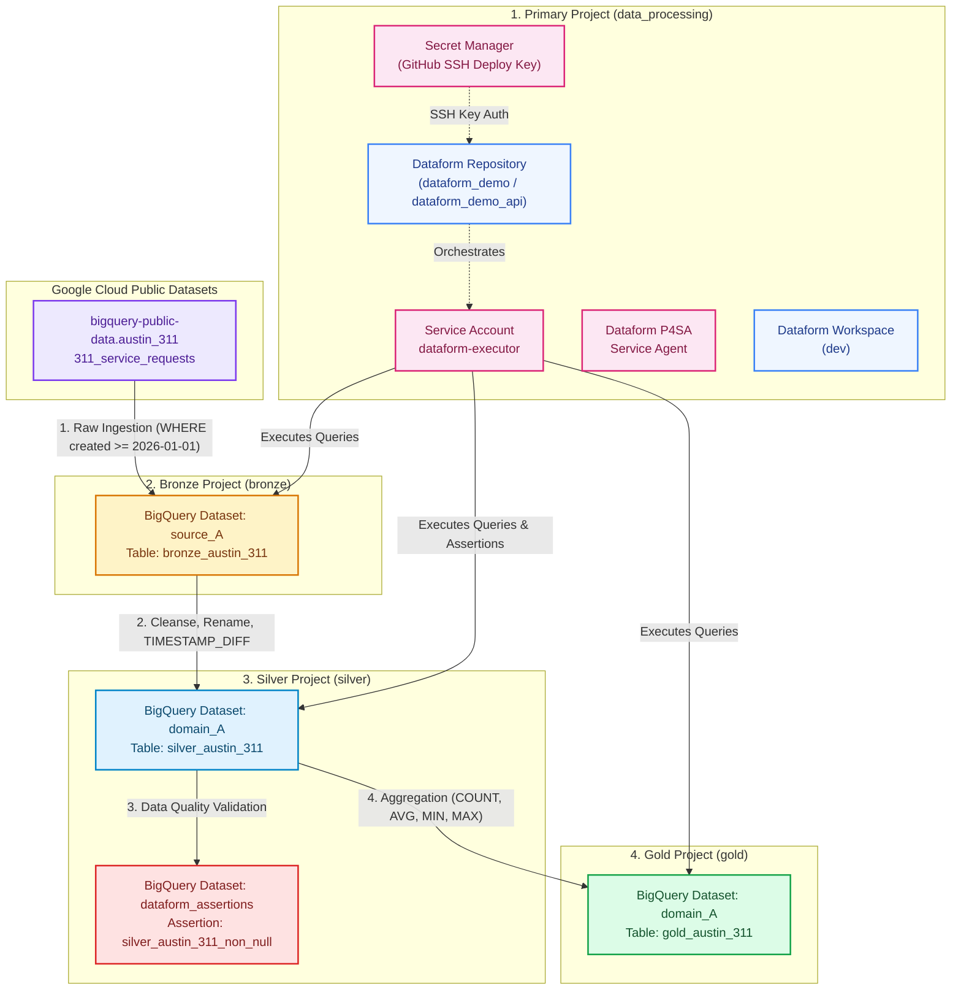

# Dataform Demo Project

This project demonstrates a simple ELT pipeline using Dataform and BigQuery Public Datasets.

Repository provisioned by Cloud Demo Platform.

## Project Structure

- `workflow_settings.yaml`: Project configuration.
- `definitions/sources/austin_311.sqlx`: Declaration of the public dataset source.
- `definitions/bronze/bronze_austin_311.sqlx`: Ingestion of raw data into the `bronze` dataset.
- `definitions/silver/silver_austin_311.sqlx`: Transformation of data into the `silver` dataset.
- `definitions/gold/gold_austin_311.sqlx`: Aggregation and final presentation of data into the `gold` dataset.


### Architecture Diagram



---


### Prerequisites
Before deploying the Terraform configuration, ensure you have the following ready:
> [!IMPORTANT]
> The implementation can be on multiple or a single GCP Project.

1. **GCP Project**:
   Choose either options:

   **A. 4 GCP Projects Created**:
      - ***Primary Data Processing Project***: Hosts Dataform repository, Service Account, and Secret Manager (e.g., `data-processing`).
      - ***Bronze Target Project***: Hosts the raw ingestion dataset (e.g., `bronze`).
      - ***Silver Target Project***: Hosts cleansed datasets and assertions (e.g., `silver`).
      - ***Gold Target Project***: Hosts final analytical aggregation tables (e.g., `gold`).

         ```bash
         [GCP Organization](OPTIONAL)
            └── [GCP Folder] dataform-demo (OPTIONAL)
                  ├── [GCP Project] data-processing
                  ├── [GCP Project] bronze
                  ├── [GCP Project] silver
                  └── [GCP Project] gold
         ```

   **B. Single Execution GCP Project**:
      - ***Data Processing Project***: Hosts Dataform repository, Service Account, Secret Manager and Datasets represting medallion architecture.

         ```bash
         [GCP Organization](OPTIONAL)
            └── [GCP Project] data-processing
         ```

2. **User IAM Roles** (on all 4 projects or single project):
   - `roles/resourcemanager.projectIamAdmin` (or `roles/owner`).
   - `roles/bigquery.admin`.
   - `roles/secretmanager.admin`.
   - `roles/dataform.admin`.
2. **Local Tools**:
   - [Terraform](https://www.terraform.io/) >= 1.5.0
   - [Google Cloud SDK (`gcloud`)](https://cloud.google.com/sdk/docs/install)
   - Python 3.8+ (for REST API simulation runner)
   - Git CLI
---

### Step-by-Step Deployment Instructions

#### Step 1: Generate SSH Keys for Git Remote Authentication
Dataform requires an SSH key to synchronize with your remote Git repository (GitHub / Git-on-Borg).

1. In the repository root, create the `keys/` directory (if not already present):
   ```bash
   mkdir -p keys
   ```
2. Generate an RSA 4096-bit key pair inside `keys/`:
   ```bash
   ssh-keygen -t rsa -b 4096 -C "dataform-demo" -f keys/dataform-demo -N ""
   ```
   This produces `keys/dataform-demo` (private key) and `keys/dataform-demo.pub` (public key).


#### Step 2: Register the SSH Public Key on GitHub
1. Copy the public key contents:
   ```bash
   cat ../keys/dataform-demo.pub
   ```
2. Navigate to your GitHub repository $\rightarrow$ **Settings** $\rightarrow$ **SSH and GPG keys** $\rightarrow$ **New SSH key**.
3. Title: `Dataform Demo Deploy Key`.
4. Paste the key and ensure **Allow write access** is checked (required if Dataform workspaces commit back to the repo).
5. Click **Add key**.


#### Step 3: Configure Terraform Variables
Edit `terraform/terraform.tfvars` with your project IDs and repository details:

> [!NOTE]
> To deploy all medallion layers into a single project:
> - Use the same `project_id` across the bronze, silver, and gold layer configurations in `arch_config`.
> - Assign a distinct `default_schema` to each layer to keep datasets properly separated in BigQuery.

```hcl
# Medallion Architecture and Data Processing Configuration
arch_config = {
  data_processing = {
    project_id       = "YOUR_DATA_PROCESSING_PROJECT_ID"
    default_schema   = "data_processing"
  }
  bronze = {
    project_id       = "YOUR_BRONZE_PROJECT_ID"
    default_schema   = "raw"
  }
  silver = {
    project_id       = "YOUR_SILVER_PROJECT_ID"
    default_schema   = "cleanse"
  }
  gold = {
    project_id       = "YOUR_GOLD_PROJECT_ID"
    default_schema   = "data_product"
  }
}

# Release configurations
git_commitish             = "main"
release_config_name       = "main"

# Service Account Name & Regional Configuration
sa_name                 = "dataform-executor"

# Region for BQ Datasets
location                = "US"
assertion_dataset_id    = "dataform_assertions"

# Dataform Integration Setup:
dataform_repository_name = "dataform_demo"
dataform_region         = "us-central1"
enable_dataform_workflow = true

# API Simulation Minimal Repository & Workspace
dataform_repository_api_name = "dataform_demo_api"
dataform_workspace_api_name  = "dev"

# Git Repository Settings
git_remote_url          = "git@github.com:YOUR_ORG/YOUR_REPO.git"
git_default_branch      = "main"

# Secret Manager Settings
secret_manager_id       = "GitHubSSH"
key_name                = "dataform-demo"

```


#### Step 4: Run Initial Terraform Apply
2. Auth to GCP:
   ```bash
   gcloud auth login --update-adc
   ```

2. Initialize Terraform:
   ```bash
   cd terraform
   terraform init
   ```
3. Apply base infrastructure (enables APIs, creates BigQuery datasets, Service Accounts, Secret Manager secrets, and Dataform repositories):
   ```bash
   terraform apply
   ```
   Terraform will now create the **Release Configurations** and **Workflow Configurations** for `bronze`, `silver`, and `gold`, binding them to their respective Git branches and compilation variables.
---

## 3. Demo Walkthrough

### Walkthrough Options
You can present this demo via two distinct methods depending on the audience:
- **Method 1**: Using the **Dataform Cloud Console UI** (best for interactive stakeholder presentations).
- **Method 2**: Using the **Direct REST API Simulator** (best for DevOps / CI/CD automation discussions).

> [!WARNING] 
> Wait ~5 min after deployment to allow Service Account credentials to propagate. If it fails with error message: *"... does not have permission to generate tokens for dataform-executor@..."* wait additonal ~2 min and retry. 

### Method 1: Dataform Cloud Console UI Walkthrough

#### Step 1: Open Dataform in Google Cloud Console
1. Navigate to [Google Cloud Console](https://console.cloud.google.com/).
2. Select your **Primary Data Processing Project**.
3. In the navigation menu, go to **BigQuery** $\rightarrow$ **Dataform**.
4. Click on repository `dataform_demo`.

#### Step 2: Explore Code & Lineage in a Development Workspace
1. In the **Development Workspaces** tab, open or create a workspace (e.g., `dev`).
2. Explore the file tree under `definitions/`:
   - `sources/austin_311.sqlx`
   - `bronze/bronze_austin_311.sqlx`
   - `silver/silver_austin_311.sqlx`
   - `silver/silver_austin_311_assertions.sqlx`
   - `gold/gold_austin_311.sqlx`
3. Click on any file (e.g., `gold_austin_311.sqlx`) and select **Compiled Query** and **Dependency Tree** at the bottom to inspect the generated SQL and visual DAG lineage across projects.

#### Step 3: Run Workflow Configurations
1. Go to the **Release & scheduling** tab in the repository.
2. In the **Workflow configurations** section, you will see three pre-configured workflows:
   - `bronze` (invokes tag `bronze`)
   - `silver` (invokes tag `silver` + dependencies)
   - `gold` (invokes tag `gold` + transitive dependencies)
3. Click **Execute** on `gold`.
4. Click **Start execution**. Dataform executes the entire chain:
   - Compiles definitions using multi-project variables.
   - Extracts raw records into `bronze_austin_311`.
   - Cleanses and transforms data into `silver_austin_311`.
   - Runs data assertion test `silver_austin_311_non_null`.
   - Aggregates final metrics into `gold_austin_311`.
5. Go to the **Executions** tab to view live logs, action statuses, and execution timing.

---

### Method 2: Headless REST API CI/CD Simulator Walkthrough

For automated pipelines (e.g., Cloud Build, GitHub Actions, GitLab CI), the repository includes an automated REST API runner: `api_simulation/run_simulation.sh`.

> [!CAUTION]
> This simulation is locked for the demo as-is. Any modifications (such as adding a new layer) will not be saved and will likely cause the simulation to fail. 

#### What the Script Does:
1. **Pushes Local Files**: Discovers local `.sqlx`, `.yaml`, and `.js` files and uploads them into the Dataform Workspace via the `:writeFile` and `:commit` REST APIs.
2. **Compiles Workspace on Demand**: Calls `compilationResults.create` with dynamic project IDs and dataset names injected as compilation variables.
3. **Executes & Live-Polls Pipeline**: Calls `workflowInvocations.create` with the execution Service Account and streams BigQuery job statuses directly in the terminal until `SUCCEEDED` or `FAILED`.

#### Executing the Simulation:
1. Authenticate local Application Default Credentials (ADC):
   ```bash
   gcloud auth login --update-adc
   ```
2. Install Python dependencies:
   ```bash
   pip install -r api_simulation/requirements.txt
   ```
3. Run the full pipeline simulation (auto-detects project settings from `terraform.tfvars`. *NOTE:* Commented lines are ignored):
   ```bash
   ./api_simulation/run_simulation.sh
   ```

#### Additional Simulation Commands:
- **Execute specific Medallion layers by Tag**:
  ```bash
  # Execute only Bronze layer with full refresh
  ./api_simulation/run_simulation.sh -p YOUR_PROJECT -r dataform_demo_api -w dev -t bronze --full-refresh

  # Execute Silver and Gold layers
  ./api_simulation/run_simulation.sh -p YOUR_PROJECT -r dataform_demo_api -w dev -t silver gold
  ```
- **Direct Python Invocation**:
  ```bash
  python3 api_simulation/dataform_api_sync.py \
    --project YOUR_DATA_PROCESSING_PROJECT_ID \
    --location us-central1 \
    --repository dataform_demo_api \
    --workspace dev \
    --service-account dataform-executor@YOUR_DATA_PROCESSING_PROJECT_ID.iam.gserviceaccount.com \
    --bronze-project YOUR_BRONZE_PROJECT_ID \
    --silver-project YOUR_SILVER_PROJECT_ID \
    --gold-project YOUR_GOLD_PROJECT_ID \
    --tags gold
  ```


---


